# GRAINYNIGHTMARE

A real-time 3D recreation of one photograph: a wind farm at dusk, black against a bruised sky, red aviation lights blinking, everything swimming in film grain.

### ▶ **[Play it: mpts.ie/games/grainy](https://mpts.ie/games/grainy/)**

A single `index.html`, [three.js](https://threejs.org) from a CDN, no build step.

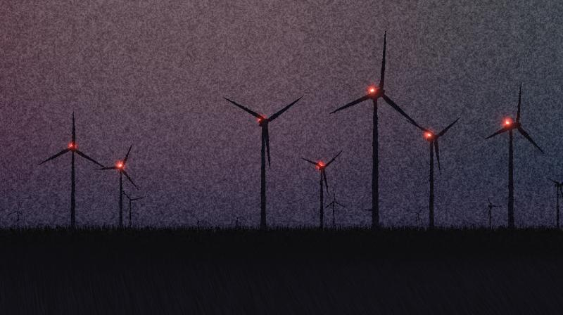

---

## The source photograph

Everything started from this one image. Colours, the sky gradient, the grain, and where every windmill stands were all measured from it rather than eyeballed.

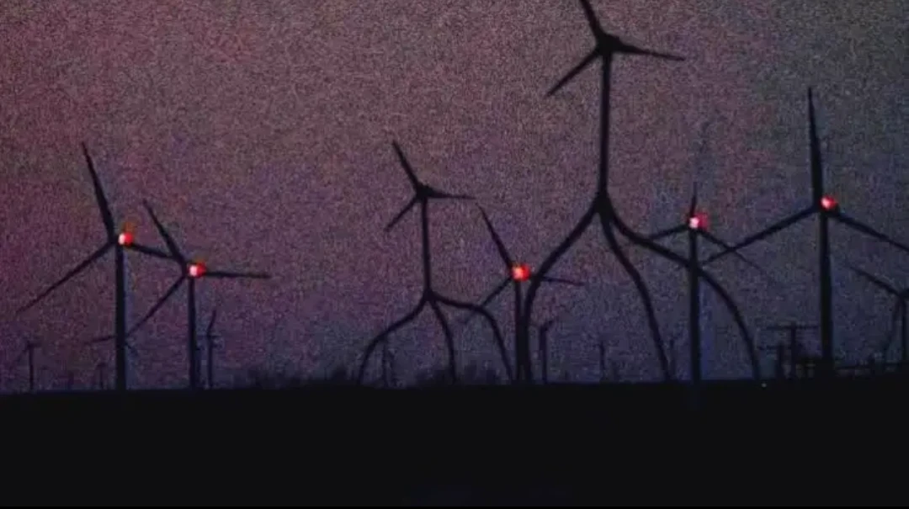

---

## Four scenes

Switch with **← / → / Space**, or click the names in the lower left. Each switch dips through black.

### WINDMILLS
Seventeen windmills placed where the photograph has them, plus a field of distant ones beyond the frame for wide windows. Rotors spin with real inertia and yaw into the wind. Each machine has its own blade length and thickness.


### PYLONS 1
A line of transmission pylons marching away into the horizon, wires sagging between them and swaying in the wind, a distant row behind.

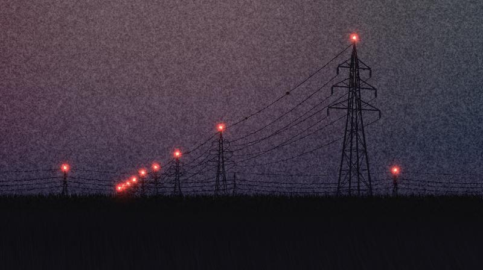

### PYLONS 2
The same pylons, but running straight across the frame from left to right.

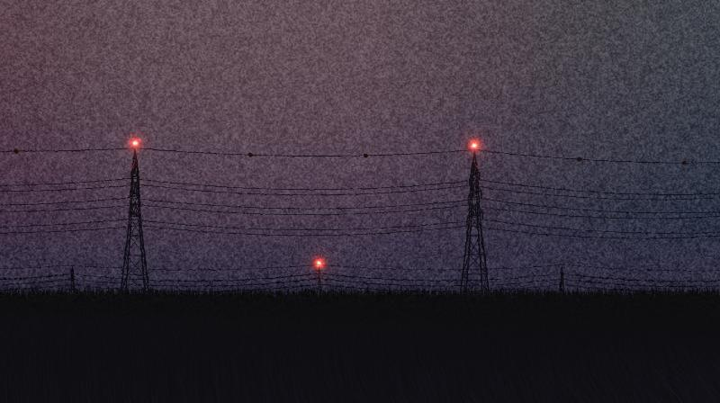

### BLANK
Just the dusk, the ground and the grass.

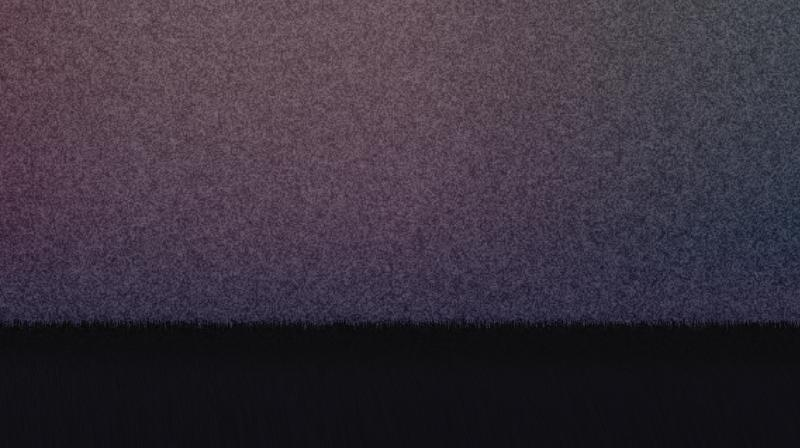

---

## Controls

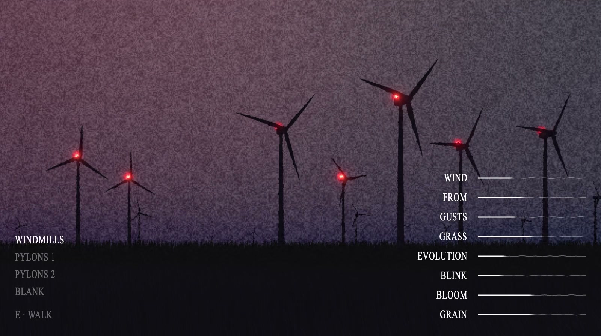

| Slider | What it does |
|---|---|
| **WIND** | Wind speed, 0–25 m/s. Drives rotor speed, grass lean and wire blow-out. |
| **FROM** | Wind direction (where it blows *from*). Windmills turn to face it. |
| **GUSTS** | How much the wind surges and drops. |
| **GRASS** | How far the grass sways. |
| **EVOLUTION** | How fast the sky evolves, 0–4×. 0 freezes it at its current state. |
| **BLINK** | Seconds between each beacon's flashes. They are all out of step. |
| **BLOOM** | The glow around the red lights. |
| **GRAIN** | Film grain strength, 0–2×. |

Sliders ease to their targets with exponential smoothing (a first-order low-pass filter), so cranking the wind up spins the rotors up gradually instead of snapping.

**E** starts walking (on a phone, tap **E · Walk**; see [On a phone](#on-a-phone)).

**The HUD gets out of the way by itself.** It fades after a few seconds without input (3.5 s on desktop, 5 s on touch) and wakes on mouse movement, a tap, or a key. It stays awake while the pointer is over it or a slider is being dragged. While walking, only hovering the mouse wakes it, so look-drags and WASD never do. **H** pins it hidden for clean captures.

---

## Walk the scene

Press **E**. The camera eases from the fixed telephoto composition down to eye level, 1.7 m above the real terrain, and you can walk around the world in first person.

- **WASD** to move, **Shift** to run, **drag** to look around (on touch: left thumb joystick, drag anywhere else to look)
- Windmill towers and pylons are solid
- Press **E** again to return to the composition

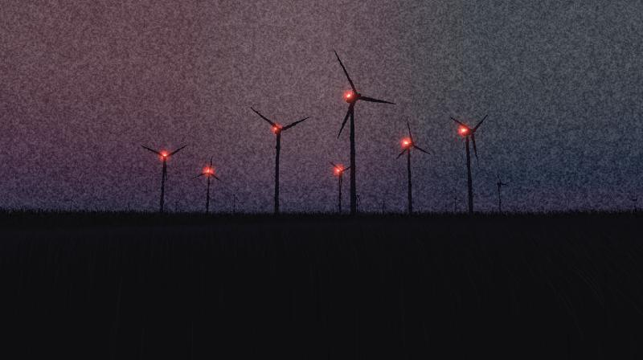

Standing under a pylon, looking up, with the beacon flashing overhead:


The camera has a touch of cinematic lag: look direction and position are pulled toward your input by a **critically damped spring** (damping ratio 1: the fastest settle with no overshoot, so it feels weighty but never wobbles). It settles in about 0.2 s and is frame-rate independent.

The grass follows you (a meadow that tiles around the player and a ring of horizon stubs that travels with you), so the field never runs out. Beacon glows stay a fixed size from far away, to match the photograph, and grow physically as you get close.

---

## On a phone

The page works in portrait (9:16 and friends). The fixed composition was framed for a wide photograph, which on a tall screen would keep only a sliver of it, so the camera adapts to the screen's shape:

- **It widens** to keep a minimum horizontal field of view, so the windmills, pylons and their beacons still fit across the width.
- **The horizon lifts** from 76% down the screen to about 58%, so the machinery sits mid-screen with the dark ground below it (where the controls live) instead of low in a sea of sky.
- **Each scene turns toward its subject**: Pylons 1 swings a few degrees toward the near pylon, Pylons 2 toward its pair.
- **Glows are sized by angle**, so the red lights stay in proportion to the machines at any framing, and grain is sized by the screen's shape so it stays fine on a tall screen.
- Rendering is lighter on touch devices (lower pixel ratio).

| Windmills | Pylons 1 | Pylons 2 |
|:---:|:---:|:---:|
| 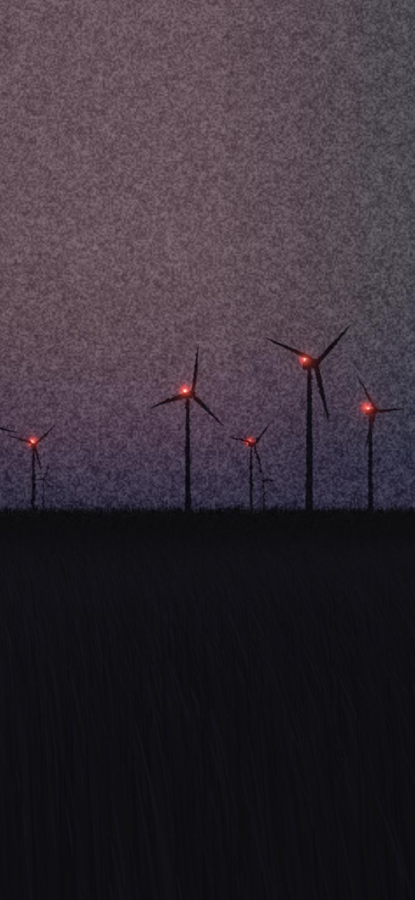 | 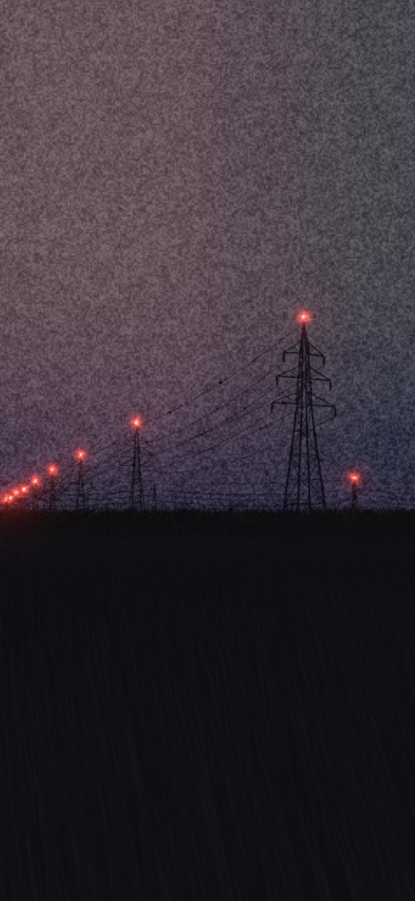 | 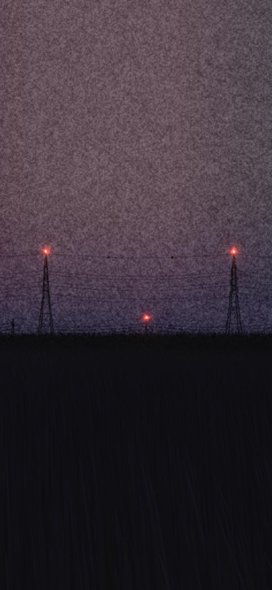 |

Landscape is unchanged: at the reference shape the camera is exactly the original 30° framing.

### Touch controls

Tap the scene names to change scene. The page never captures swipes outside walk mode, so pull-to-refresh and normal scrolling still work. There is no HUD button: the sliders and scene list fade out after a few idle seconds and come back when you touch the screen (the first tap just wakes them; it won't move a slider).

Tap **E · Walk** and the screen becomes the controls:

- the **bottom-left** is a floating **joystick**: it appears wherever your thumb lands, and pushing further goes faster (past about 70% of the radius you run)
- **everywhere else** drags the camera to look around
- **everywhere else** drags the camera to look around

The two thumbs work independently, so you can walk and look at the same time.

| HUD | Walking, joystick engaged |
|:---:|:---:|
| 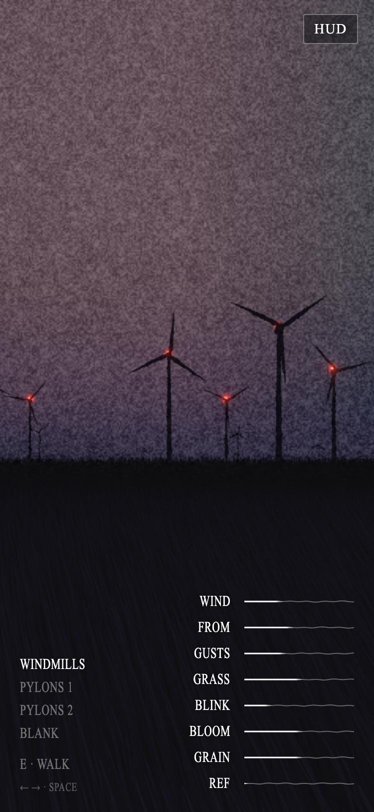 | 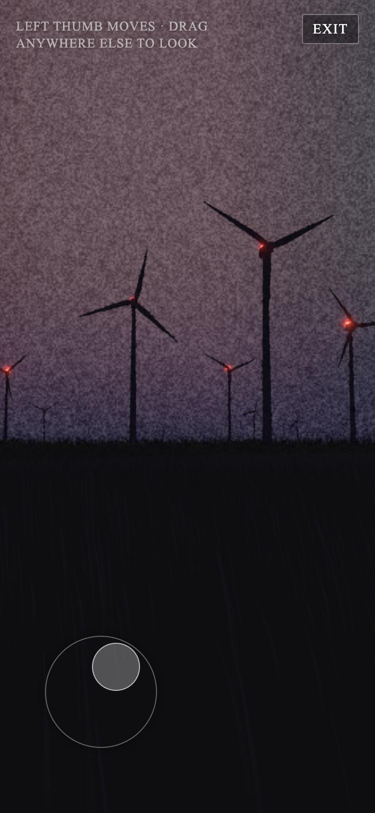 |

---

## Up close

The windmills and pylons are modelled, not sprites.

**Windmills** have a lathe-turned tower in flanged sections, a bevelled nacelle with a radiator, anemometer and vane, an ogive spinner, and blades lofted from airfoil sections with taper and twist:

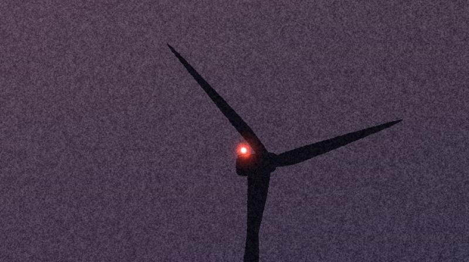

**Pylons** are built beam by beam: four tapering legs, horizontal bars with X-bracing, three tiers of cross-arms, hanging insulator strings, a peak, and conductors that sag and blow downwind. Every member ends on another member; the design (9 horizontal bars, 1.0× thickness) was chosen from a 5×5 grid of complexity against thickness.

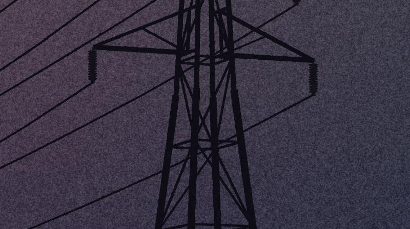

Thin parts widen in the vertex shader to at least about a pixel so far-off wires never vanish.

---

## A living sky

The sky is not a fixed gradient. It is **10 soft globs** drifting over a base colour, above two thin bands of horizon haze. Each glob is a signed colour offset with a gaussian falloff (a warm glow where it is positive, a cool shadow where it is negative):

```
colour = base + Σ haze · e^(−y/ε) + Σ strength · offset · e^(−(1 − cos θ)/σ²)
         y = sin(elevation), θ = angle from the glob's centre, σ = its size
```

Over time each glob drifts round the sky (0.2–0.7°/s), rises and sinks, swells and fades, and shifts colour; the haze thickens and thins. The **EVOLUTION** slider sets the rate.

**Every visit opens on a different sky.** A random seed picks each glob's motion and a random start time (1–10 minutes in) picks how far it has already drifted, so each load is a different, naturally evolved version of the same dusk: sometimes violet, sometimes mauve, occasionally green. Two URL options pin it down:

| URL | Sky |
|---|---|
| `?sky=fitted` | the fitted starting state, matching the photograph (as in the parity sheet below) |
| `?seed=N&t=S` | one particular sky, for sharing a good one (in the console, `__sky().link` gives the link for the current sky) |
| `?evolution=N` | start the sky evolving at N× (the **EVOLUTION** slider's starting value; above 4× the slider extends to fit). Combines with the others, e.g. `?seed=11&t=300&evolution=30` |

### Starting where the photograph is

At t = 0 the globs reproduce the gradient measured from the photograph. [`tools/fit_sky.py`](tools/fit_sky.py) fits them over the **whole sphere**, not just the visible frame, so the match holds wherever you look. Because the model is linear in its colours, those are solved exactly for any placement of the globs and only their positions and sizes are searched (variable projection). The two haze bands exist because the darkening in the bottom 2° of sky is too thin for any glob broad enough to drift nicely.

Measured against the previous gradient sky, at three headings, the match is about **2 bytes RMS out of 255**, below the ~9-byte film grain:

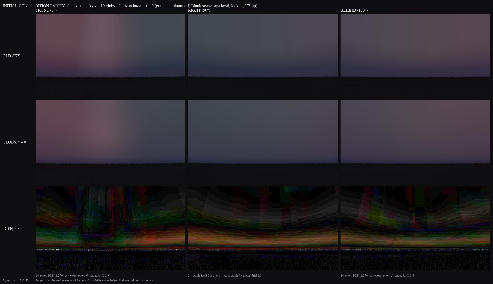

### How it evolves

The same three headings at 0, 90 and 240 seconds:

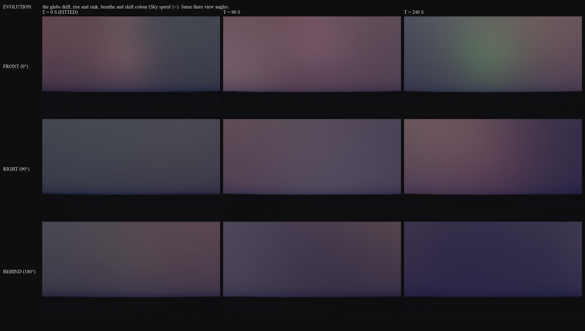

To refit: `python3 tools/fit_sky.py` (about 4 minutes) writes `tools/sky_blobs.json`, and `python3 tools/apply_sky.py` writes it into the page.

---

## Lighting: only the red lights

There is no sun, no sky light and no environment map on the 3D objects. Everything has a fixed near-black base, so it reads as a silhouette. **The only thing that ever lights an object is a flashing red beacon**: each has an emissive housing, a glow sprite, and a real point light that briefly lights the nacelle or pylon top around it.

Beacons are desynchronised and slow by design: the base interval is stretched by (number of lit windmills × 2), so the farm blinks lazily and out of step.

### Bloom

The light cores are drawn far brighter than white in a half-float target, and a multi-level blur spreads them. Without bloom the lights are just dots; with it they glow and spill over the silhouettes.

| Bloom off | Bloom 2× |
|---|---|
| 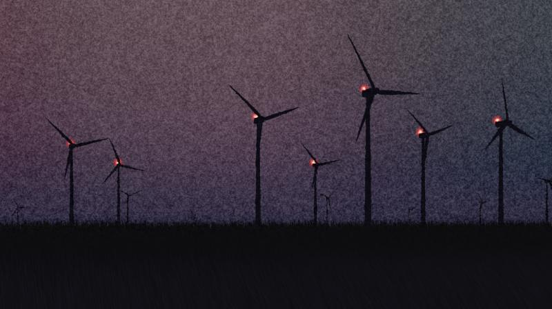 | 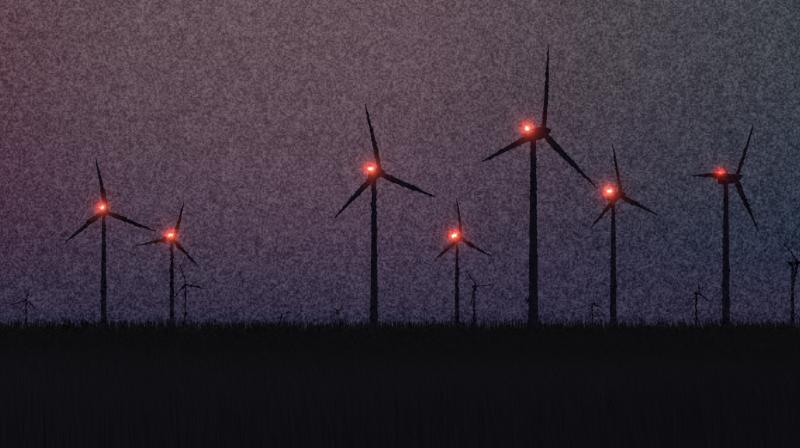 |

---

## Grain

Grain was measured from a flat patch of sky in the photograph: standard deviation of about 9 out of 255, greyscale (channels correlate above 0.95), neighbouring pixels correlated about 0.8 at one pixel and 0.5 at two. The renderer reproduces that with a fine layer and two coarser blotch layers, refreshed 24 times a second.

Two details make it more than a texture:

- **Grain is a distortion, not just a tint.** The same noise also displaces where the scene is sampled, so edges, blade tips and light glows get ragged and shimmer.
- **Grain grows with distance.** Every surface writes its distance from the camera into the alpha channel, and grain strength scales with it. The sky gets the full amount; the ground at your feet gets almost none.

| Grain off | Grain 2× |
|---|---|
| 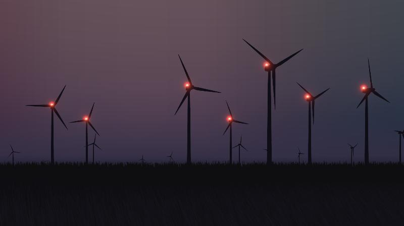 | 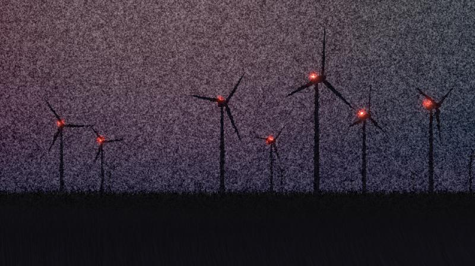 |

---

## How it was built

- **Measured, not guessed.** The sky gradient was measured row by row from the photograph (using the brightest 40% of each row so silhouettes do not skew it): `rgb(106,81,91)` at the top, down to `rgb(33,31,50)` at the horizon, plus a left-to-right tint (pinker on the left, bluer and darker on the right). That measurement is now the starting state the sky's globs are fitted to (see [A living sky](#a-living-sky)).
- **The horizon is ragged.** The photograph's horizon is a broken edge of grass stubs, not a fade, so it is built from 110,000 sized-in-pixels blades that sway in the wind.
- **Linear-light pipeline.** Sampled sRGB values are converted to linear on the way in; lighting and bloom happen in linear; a final pass encodes back to sRGB and adds grain.
- **Terrain.** The ground is never perfectly flat: a gentle undulation shared between the CPU (placement, collisions) and the shaders.

## Run it locally

```bash
python3 -m http.server 8765
# then open http://localhost:8765/index.html
```

It needs a local server (not `file://`) because it loads three.js as an ES module.

## Deploy

The live page is a [Cloudflare Worker](worker/) serving this repo's `index.html` at `mpts.ie/games/grainy`.

```bash
cd worker
./deploy.sh        # copies the page into worker/public and runs `wrangler deploy`
```

See [`worker/`](worker/) for the config.

mpts.ie itself is [BannerAndLogo](https://github.com/nassir90/BannerAndLogo) on `mpts.ie/*`; this route is more specific, so it wins. Grainy Nightmare is listed on the games index, [mpts.ie/games](https://mpts.ie/games/), and has a stack of clips on the home page (BannerAndLogo's `site/games/index.html` and `site/index.html`), so a changed route needs updating there too.

## Files

```
index.html     the whole game
docs/          screenshots used in this README
tools/         the sky fit (fit_sky.py) and the script that writes it into the page (apply_sky.py)
DEPENDENCIES.md  what the project depends on, and what we wrote by hand that libraries also cover
worker/        Cloudflare Worker that serves the page at mpts.ie/games/grainy
```
